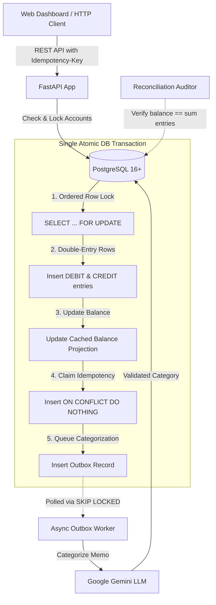

# Payment Ledger & Real-Time Auditor

A double-entry payment ledger API and real-time interactive auditor dashboard built with **Python 3.12+, FastAPI, and PostgreSQL 16+**. Engineered for mathematical correctness, race-free concurrency under high contention, append-only ledger integrity, and race-safe API idempotency.

---

## Architecture Overview



---

## Key Guarantees

1. **Conservation of Money:** Every transfer creates exactly two immutable ledger entries (one debit, one credit) in a single database transaction satisfying $\sum \text{entries} = 0$.
2. **Deadlock-Free Pessimistic Locking:** Account row locks are always acquired in strictly sorted UUID order (`min(from_id, to_id)` then `max(from_id, to_id)`), preventing circular wait conditions.
3. **Zero Floating-Point Drift:** Monetary values are transported over the wire as decimal strings (e.g. `"150.75"`), manipulated as `decimal.Decimal`, and stored in PostgreSQL as `NUMERIC(18,2)`.
4. **Race-Safe Idempotency:** Duplicate or re-transmitted requests are serialized inside the transfer transaction using primary key `ON CONFLICT DO NOTHING` claims and SHA-256 payload hashing.
5. **Decoupled AI Processing:** The critical payment path never synchronously calls external AI services; an asynchronous transactional outbox worker polls with `SELECT ... FOR UPDATE SKIP LOCKED` and falls back safely to `UNCATEGORIZED`.
6. **Append-Only Immutability:** Database-level guards reject any `UPDATE` or `DELETE` statements on `ledger_entries`.

---

## Quickstart Guide

### Option A: Local Development (PostgreSQL on host)
1. Ensure PostgreSQL is running and create the databases:
   ```bash
   psql -U postgres -c "CREATE DATABASE payment_ledger;"
   psql -U postgres -c "CREATE DATABASE payment_ledger_test;"
   ```
2. Configure your environment:
   ```bash
   cp .env.example .env
   # Edit .env with your local credentials
   ```
3. Install dependencies:
   ```bash
   pip install -e .[dev]
   ```
4. Run the API server:
   ```bash
   uvicorn app.main:app --reload --port 8000
   ```
5. Test liveness and readiness:
   ```bash
   curl http://localhost:8000/api/v1/health
   curl http://localhost:8000/api/v1/ready
   ```

### Option B: Docker Compose
```bash
docker compose up --build
```

---

## Project Structure

```
payment-ledger/
  app/
    main.py                  # FastAPI application entrypoint, middleware, static mounts
    config.py                # Environment configuration (Pydantic Settings)
    db.py                    # Async SQLAlchemy engine & async sessionmaker
    models/                  # SQLAlchemy ORM declarations
    schemas/                 # Pydantic v2 boundary models
    api/                     # Route definitions (HTTP boundary only)
    services/                # Core business logic (Transfer, Idempotency, Reconciliation)
    workers/                 # Background workers (Outbox worker)
    static/                  # Real-time web dashboard (Vanilla HTML5 / CSS / JS)
  migrations/                # Alembic database migrations
  tests/                     # Unit, integration, and concurrency test suites
  benchmarks/                # k6 load testing scripts
  docs/                      # Architecture, design decisions, learning notes, results
```

---

## Running Verification & Tests

- **Run all automated tests:**
  ```bash
  pytest -v
  ```
- **Check code formatting:**
  ```bash
  black --check .
  ```
- **Lint code:**
  ```bash
  ruff check .
  ```
- **Check static types:**
  ```bash
  mypy app
  ```

---

## Benchmark Results

Benchmark results, hardware specifications, and statistical spreads across runs are documented in [`docs/RESULTS.md`](docs/RESULTS.md).

---

## Design Tradeoffs & Known Limitations

- **Pessimistic vs. Optimistic Locking:** Pessimistic locking (`SELECT FOR UPDATE`) was chosen over optimistic locking (`version` column retry loops) because hot merchant accounts under high transfer contention suffer from high retry churn and wasted CPU cycles under optimistic schemes.
- **Single-Machine Scope:** The current implementation runs against a single PostgreSQL instance. At Visa or Stripe scale, horizontal sharding by account ID, read replicas for audit queries, and cross-shard two-phase commit (2PC) or Saga orchestrators would be required.
- **PCI Compliance & Card Tokenization:** This project models card lifecycle state transitions (`AUTHORIZED`, `CAPTURED`, `SETTLED`, `VOIDED`, `REFUNDED`) and available balance holds. In compliance with PCI-DSS Level 1, raw Primary Account Numbers (PANs) are never accepted or stored; real systems utilize third-party tokenization vaults (e.g. Stripe Elements or Visa Token Service).

---

## Next Steps

1. Phase 1: Complete Alembic migrations and account management endpoints.
2. Phase 2: Double-entry transfer engine with deadlock-free row locking.
3. Phase 3: Race-safe idempotency claim flow.
4. Phase 4: Append-only ledger trigger and automated reconciliation auditor.
5. Phase 5: Transactional outbox worker with Google Gemini LLM integration.
