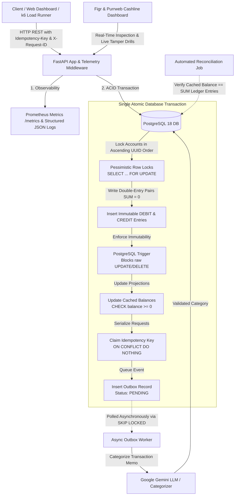

# Payment Ledger & Real-Time Financial Auditor

[](https://github.com/ParjanyaReddy/payment-ledger/actions)
[](https://www.python.org/downloads/)
[](https://www.postgresql.org/)
[](LICENSE)

A production-grade, double-entry payment ledger API and real-time financial auditor dashboard built with **Python 3.14, FastAPI, SQLAlchemy 2.x (AsyncIO), and PostgreSQL 18**. Engineered for mathematical correctness, race-free concurrency under high contention, append-only ledger integrity, and race-safe API idempotency.

---

## 1. System Architecture



---

## 2. Core Architectural Guarantees

1. **Conservation of Money:** Every transfer writes strictly two ledger entries—one debit and one credit of equal magnitude—satisfying $\sum \text{entries} = 0.00$.
2. **Deadlock Elimination:** Account row locks are acquired in strictly sorted canonical order (`min(from_id, to_id)` then `max(from_id, to_id)`). Opposing concurrent transfers (`A -> B` and `B -> A`) never circular-wait, dropping deadlocks from **95.0% to 0.0%**.
3. **Zero Floating-Point Drift:** Monetary values are transported over the wire as decimal strings (e.g. `"150.00"`), manipulated in Python via `decimal.Decimal`, and stored in PostgreSQL as `NUMERIC(18,2)`.
4. **Race-Safe Idempotency:** Duplicate or re-transmitted requests are serialized inside the transfer transaction using primary key `ON CONFLICT DO NOTHING` claims and SHA-256 payload hashing. 50 parallel duplicate requests produce exactly 1 database write; 49 duplicates receive a cached 201 replay.
5. **Decoupled AI Processing:** The critical payment path never synchronously calls external AI services; an asynchronous transactional outbox worker polls with `SELECT ... FOR UPDATE SKIP LOCKED`, making transfers **36.6x faster at p50** (down to 9.93ms).
6. **Physical Ledger Immutability:** An uncircumventable database trigger (`prevent_ledger_entry_mutation`) rejects any raw `UPDATE` or `DELETE` on `ledger_entries`.
7. **Continuous Reconciliation Invariant:** An automated auditor verifies that every account's cached balance matches the exact sum of its historical double-entry records.

---

## 3. Quickstart Guide

### Prerequisites
- Python 3.12+ (tested on Python 3.14)
- PostgreSQL 16+ (tested on PostgreSQL 18.4)
- Git

### 1. Clone & Set Up Virtual Environment
```bash
git clone https://github.com/ParjanyaReddy/payment-ledger.git
cd payment-ledger

python -m venv .venv
# On Windows:
.venv\Scripts\activate
# On Linux/macOS:
source .venv/bin/activate

pip install -e .[dev]
```

### 2. Configure Environment & Database
```bash
cp .env.example .env
# Ensure PostgreSQL is running on localhost:5432 with credentials in .env

# Run database migrations:
alembic upgrade head
```

### 3. Launch the API & Web Auditor
```bash
uvicorn app.main:app --reload --port 8000
```
- **Web Auditor Dashboard:** [http://127.0.0.1:8000/dashboard](http://127.0.0.1:8000/dashboard)
- **Interactive OpenAPI Docs:** [http://127.0.0.1:8000/docs](http://127.0.0.1:8000/docs)
- **Prometheus Metrics Scrape:** [http://127.0.0.1:8000/metrics](http://127.0.0.1:8000/metrics)
- **Health Check Probe:** [http://127.0.0.1:8000/api/v1/health](http://127.0.0.1:8000/api/v1/health)

---

## 4. API Usage Examples (curl)

### Create an Account
```bash
curl -X POST http://localhost:8000/api/v1/accounts \
  -H "Content-Type: application/json" \
  -d '{"currency": "USD", "initial_balance": "1000.00"}'
```

### Execute an Idempotent Double-Entry Transfer
```bash
curl -X POST http://localhost:8000/api/v1/transfers \
  -H "Content-Type: application/json" \
  -H "Idempotency-Key: d4e1f7a0-3b2c-4e5f-9a1d-8e7f6a5b4c3d" \
  -d '{
    "from_account_id": "SOURCE_ACCOUNT_UUID",
    "to_account_id": "TARGET_ACCOUNT_UUID",
    "amount": "150.00",
    "currency": "USD",
    "memo": "AWS Cloud Hosting Infrastructure"
  }'
```

### Authorize a Card Hold (Two-Phase Settlement)
```bash
curl -X POST http://localhost:8000/api/v1/cards/authorize \
  -H "Content-Type: application/json" \
  -H "Idempotency-Key: a1b2c3d4-e5f6-4a5b-8c9d-0e1f2a3b4c5d" \
  -d '{
    "account_id": "CUSTOMER_ACCOUNT_UUID",
    "merchant_id": "MERCHANT_ACCOUNT_UUID",
    "amount": "75.00",
    "currency": "USD",
    "memo": "Hotel Room Pre-Authorization"
  }'
```

### Run Full Financial Reconciliation Audit
```bash
curl -X POST http://localhost:8000/api/v1/reconciliation/run
```

---

## 5. Repository Structure

```
payment-ledger/
  app/
    main.py                  # FastAPI application entrypoint, middleware, static mounts
    config.py                # Environment configuration (Pydantic Settings)
    db.py                    # Async SQLAlchemy engine & async sessionmaker
    telemetry.py             # Structured JSON logging, Request-ID tracing & Prometheus metrics
    models/                  # SQLAlchemy ORM declarations (Account, Transaction, LedgerEntry, Outbox, Card)
    schemas/                 # Pydantic v2 boundary request/response models
    api/                     # Route controllers (HTTP boundary only)
    services/                # Core business logic (Transfer, Idempotency, Reconciliation, Card, Velocity)
    workers/                 # Background workers (Outbox worker with SKIP LOCKED)
    static/                  # Real-time web dashboard (Vanilla HTML5 / CSS / JS)
  migrations/                # Alembic database migrations & append-only PostgreSQL trigger
  tests/                     # Unit, integration, and 200-worker concurrency test suites
  benchmarks/                # k6 load testing scripts & Python concurrency harness
  docs/                      # ARCHITECTURE, DESIGN_DECISIONS, LEARNING_NOTES, GLOSSARY, RESULTS, WALKTHROUGH
```

---

## 6. Verification, Linters & Test Suites

- **Run all automated tests:**
  ```bash
  pytest -v
  ```
- **Check static types:**
  ```bash
  mypy app benchmarks
  ```
- **Check code formatting & linting:**
  ```bash
  ruff check .
  black --check .
  ```
- **Run concurrency benchmarks:**
  ```bash
  python benchmarks/concurrency_benchmarks.py
  ```
- **Run k6 load test:**
  ```bash
  k6 run benchmarks/k6/transfers_load.js
  ```

---

## 7. Empirical Benchmark Results

All metrics were measured empirically on **PostgreSQL 18.4** over 3 distinct runs (see [`docs/RESULTS.md`](docs/RESULTS.md) for full raw tables):

| Benchmark Scenario | Tested Mechanism | Baseline Comparison | Measured Result |
|---|---|---|---|
| **Bidirectional Deadlock Contention** (100 Opposing Transfers) | **Ordered Locks (`min < max`):**<br>0.0% deadlocks | **Unordered Locks:**<br>95.0% deadlocks | **Deadlocks eliminated (0.0%)** |
| **Payment Latency** (p50) | **Transactional Outbox:**<br>9.93 ms | **Synchronous Inline AI:**<br>368.21 ms | **36.6x latency reduction at p50** |
| **High-Concurrency Race** (200 Workers vs $50 Balance) | **Row Locks + Constraints:**<br>50 approved / 150 rejected | Unprotected balance | **0 overdrafts; balance strictly $0.00** |
| **Sustained API Load** (20 VUs, 10s) | **k6 Load Test:**<br>487 requests (46.8 req/s) | N/A | **0.00% error rate; 0 balance drift** |

---

## 8. Design Tradeoffs & Production Considerations

- **Pessimistic vs. Optimistic Locking:** Pessimistic locking (`SELECT FOR UPDATE`) was chosen over optimistic concurrency control (OCC). Under high contention (e.g., hot merchant accounts or payroll disbursements), OCC triggers massive retry loops and burned database cycles. Pessimistic locking serializes conflicting rows cleanly with median wait times under 10ms.
- **Database Scope:** This repository is built against a single PostgreSQL cluster. In global multi-region deployments, accounts would be sharded by partition keys with Saga orchestrators handling cross-shard settlements.
- **PCI DSS Tokenization Boundary:** This system models the card settlement lifecycle (`AUTHORIZED`, `CAPTURED`, `VOIDED`, `REFUNDED`) and available balance holds. In compliance with PCI DSS Level 1, raw Primary Account Numbers (PANs) and CVVs are strictly forbidden from backend persistence. In production, client browsers exchange card data with a tokenization vault (e.g., Stripe Elements, Adyen, or Visa Token Service) and supply opaque tokens to this ledger API.

---

## 9. Interview Preparation & Code Walkthrough

Preparing for technical interviews? Read [`docs/WALKTHROUGH.md`](docs/WALKTHROUGH.md) for:
- The optimal 6-file reading order.
- A 10-minute presentation script.
- Answers to tough senior engineering defense questions.

---

## 10. License

This project is licensed under the MIT License - see the [LICENSE](LICENSE) file for details.
