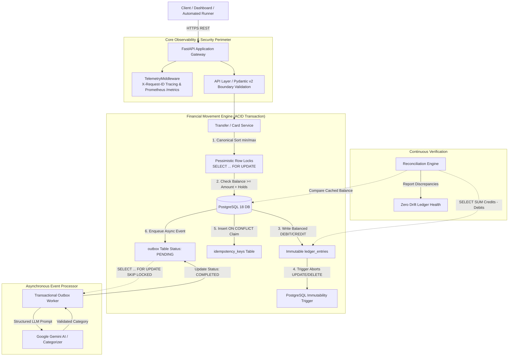

# Payment Ledger Architecture & Deep-Dive Specification

This document details the architectural topology, data access patterns, and invariant enforcement strategies of the **Payment Ledger & Real-Time Financial Auditor** system.

---

## 1. System Context & Component Diagram



---

## 2. Core Architectural Pillars

### Pillar 1: Double-Entry Conservation of Money
No account balance ever changes in isolation. Every transfer creates exactly two ledger entries in a single database transaction:
- **Sender Account:** Recorded as `DEBIT` of amount $M$.
- **Recipient Account:** Recorded as `CREDIT` of amount $M$.

The transaction double-entry invariant guarantees:
$$\sum (\text{Credits}) - \sum (\text{Debits}) = 0.00$$

### Pillar 2: Deadlock-Free Pessimistic Row Locking
When concurrent requests attempt transfers in opposing directions (`A -> B` and `B -> A`), naive implementations acquire locks in request order, producing circular wait deadlocks.
Our engine breaks Dijkstra's circular wait condition by canonically sorting the account IDs ascending before acquiring locks:
```python
sorted_ids = sorted([from_account_id, to_account_id])
stmt = (
    select(Account)
    .where(Account.id.in_(sorted_ids))
    .order_by(Account.id)
    .with_for_update()
)
```
In empirical benchmarks with 100 concurrent opposing transfers, this sorting eliminated deadlocks completely (**0.0% deadlocks vs 95.0% deadlocks** in unordered baselines).

### Pillar 3: Race-Safe Atomic Idempotency
To prevent double-charging over unreliable networks, the system implements an atomic claim pattern inside the same database transaction:
1. `INSERT INTO idempotency_keys (key, request_hash, status) VALUES (...) ON CONFLICT (key) DO NOTHING;`
2. Exactly 1 thread succeeds (row count = 1) and executes the transfer.
3. Concurrent duplicate threads fail the insert (row count = 0), wait on the row lock, and receive the cached 201 response.
4. If an existing key is reused with a modified payload, the SHA-256 hash mismatch immediately triggers `HTTP 422 Unprocessable Content`.

### Pillar 4: Decoupled Transactional Outbox
To prevent long-lived row locks on active financial accounts, external integrations (such as AI transaction categorization) are decoupled from the payment path:
- The transfer transaction commits the ledger entries and an outbox event in < 10ms.
- An asynchronous worker polls pending outbox records using `SELECT ... FOR UPDATE SKIP LOCKED`.
- This pattern reduces p50 transfer latency by **36.6x** (down to 9.93ms) and guarantees zero lock contention among concurrent worker threads.

### Pillar 5: Physical Database-Level Immutability
Historical records are protected by an uncircumventable PostgreSQL trigger:
```sql
CREATE OR REPLACE FUNCTION prevent_ledger_mutation()
RETURNS TRIGGER AS $$
BEGIN
    RAISE EXCEPTION 'ledger_entries is append-only: updates and deletes are forbidden';
END;
$$ LANGUAGE plpgsql;

CREATE TRIGGER trg_ledger_entries_immutability
BEFORE UPDATE OR DELETE ON ledger_entries
FOR EACH ROW EXECUTE FUNCTION prevent_ledger_mutation();
```

---

## 3. Database Schema Overview

| Table | Purpose | Primary Keys & Indexes | Constraints |
|---|---|---|---|
| `accounts` | Cached balance projections & ISO currencies | `id UUID PRIMARY KEY`, `currency` | `CHECK (balance >= 0)`, `CHECK (holds >= 0)`, `CHECK (balance >= holds)` |
| `transactions` | High-level business event envelope | `id UUID PRIMARY KEY`, `created_at` | `CHECK (amount > 0)`, `status IN ('PENDING', 'COMPLETED', 'FAILED')` |
| `ledger_entries` | Immutable physical debit/credit records | `id UUID PRIMARY KEY`, `(transaction_id, account_id)` | `direction IN ('DEBIT', 'CREDIT')`, `CHECK (amount > 0)`, Append-only trigger |
| `idempotency_keys`| Atomic request deduplication cache | `key VARCHAR(255) PRIMARY KEY` | `request_hash VARCHAR(64)` |
| `outbox` | Decoupled asynchronous event queue | `id UUID PRIMARY KEY`, `status`, `created_at` | `status IN ('PENDING', 'PROCESSING', 'COMPLETED', 'FAILED')` |
| `card_authorizations` | Two-phase retail card settlement holds | `id UUID PRIMARY KEY`, `account_id`, `merchant_id` | `status IN ('AUTHORIZED', 'CAPTURED', 'VOIDED', 'REFUNDED')` |
| `reconciliation_runs` | Audit verification logs | `id UUID PRIMARY KEY`, `created_at` | Stores execution time, audited count, and detected discrepancies |
